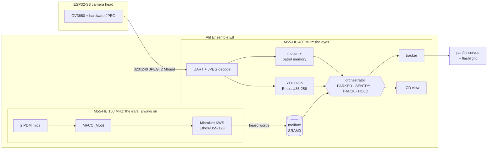
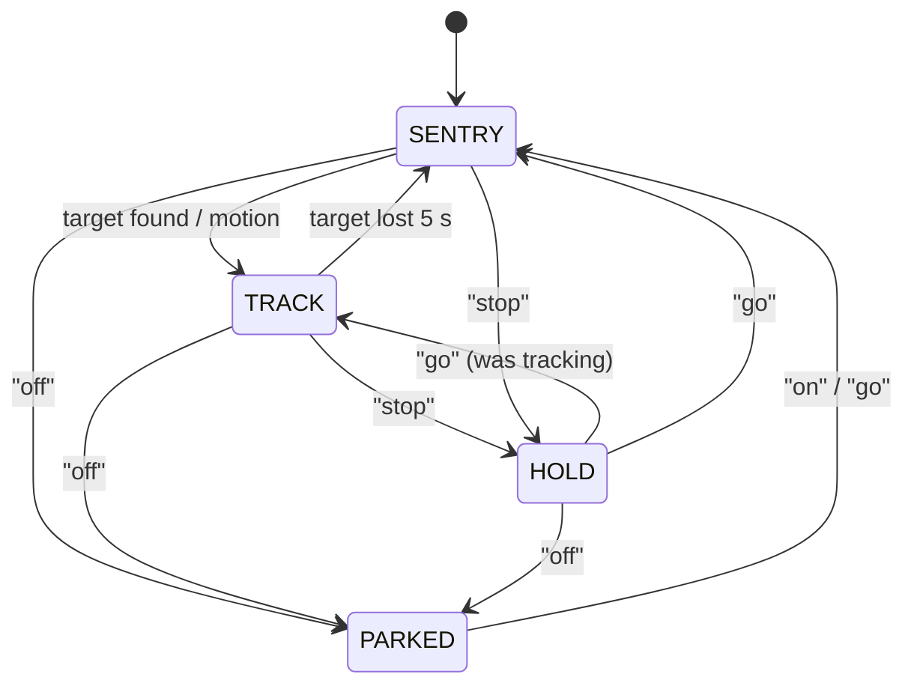

# WALDO: a voice-controlled turret that finds and follows, on one Alif E8

> **Agents and contributors: read [`documentation/jitter-hypotheses.md`](documentation/jitter-hypotheses.md) before changing the tracker or orchestrator.** It lists unverified hypotheses for the turret's jitter and aimless motion, and how to test them.

WALDO is a pan/tilt turret with a flashlight. It patrols a room, finds people
with a camera, points at them and keeps following them. You steer it by voice: "stop",
"go", "left", "off". Everything runs on the **Alif Ensemble E8 DevKit**: no PC, no cloud.

Two ExecuTorch models run on two NPUs of the same chip: **YOLOv8n on the Ethos-U85** sees,
**MicroNet on the Ethos-U55** listens. Each sits behind a Cortex-M55 of its own.

Built for the Arm + Meta ExecuTorch hackathon on this repository's `hackathon` template
([original setup guide](documentation/template-guide.md)).

<!-- demo GIF / photo goes here -->

| | |
|---|---|
| **Sees** | YOLOv8n, 28 room classes, 320x320, 99/99 operators on the Ethos-U85 |
| **Hears** | MicroNet-M, 10 command words, 42/42 operators on the Ethos-U55 (or the U85 in the single-core build) |
| **Decides** | one state machine: patrol, track, hold, park; heavy models only when something changed |
| **Moves** | two servos on hardware PWM, aimed at people's chests, not their eyes |
| **Proves itself** | boot self-tests on the board; the same tests pass on Arm's FVPs in CI |

## How it works



**Two brains.** The M55-HE listens all the time and sleeps between 16 ms audio blocks. It
posts each word it hears to a mailbox in SRAM0 ([src/waldo/brain_link.h](src/waldo/brain_link.h)).
The M55-HP does the vision and the steering, and sleeps between interrupts. This is the
split Alif's own E8 voice-to-vision demo uses: always-on sensing on the small core, heavy models on the
big one. One line in `board/DevKit-E8/Board-U85.clayer.yml` (`WALDO_TWO_BRAIN`) switches
back to a single-core build, where the HP runs both models on the U85. Details:
[he/README.md](he/README.md).

**Each job on the unit that fits it:**

| Job | Runs on | Why |
|---|---|---|
| Object detection | **Ethos-U85** via ExecuTorch | 1.09 GMAC of int8 convolutions per frame |
| Keyword spotting | **Ethos-U55** via ExecuTorch, on the HE | tiny, always on, next to the mics |
| MFCC, JPEG decode, motion, patrol memory, box decoding and NMS | **Cortex-M55** | branchy or small work, cheaper on the CPU |
| Microphones, camera bytes | PDM block, UART, both on interrupts | data arrives while the NPUs run |
| Servo PWM | UTIMER hardware | jitter-free 50 Hz, no CPU cost |
| Capture and compression | ESP32-S3 camera head | its own JPEG hardware; the E8 only decodes |

### The orchestrator

One state machine ([src/waldo/orchestrator.cpp](src/waldo/orchestrator.cpp)) decides how
much work each camera frame gets, so YOLO runs only when there is something to look at.



| State | What runs | Turret |
|---|---|---|
| PARKED | microphones only | head down as far as the laser allows (`TILT_MIN_DEG`), light on the deck |
| SENTRY | motion on every frame (CPU); YOLO only where the patrol memory says something changed | patrols: move, settle, look |
| TRACK | YOLO on every frame | follows the target |
| HOLD | YOLO on every frame | frozen |

**The patrol.** After 4 s of quiet, SENTRY sweeps a Z of 10 stops (pan -70 to 70 degrees,
two tilts): move, settle 0.6 s, look 0.7 s. Each stop keeps a 300-byte picture of itself
(the mean of every 8x8 cell, compared with one cell of slack for servo error). YOLO runs
only where that picture changed since the last lap, on a first visit, every third lap, or
when something moves. In the host test, a second lap of an unchanged room runs YOLO at
**0 of 10 stops**, and a change in the room is looked at again at the one stop that sees it (only people are followed).

**Voice commands:**

| Word | Effect |
|---|---|
| off | park |
| on / go | wake up, or resume what it was doing before "stop" |
| stop | hold still |
| left / right / up / down | while tracking: **switch to the nearest other person in that direction**; otherwise nudge 10 degrees |
| no | drop the current target and pick again among people |

The screen shows the camera view with boxes (target green, other people yellow), the state, what WALDO follows, the last word it heard, and its frame rate.

## The models

Both go through the template's flow: PyTorch, int8 PT2E with the `EthosUQuantizer`, the
Ethos-U partitioner, Vela, a `.pte` embedded in the image. Only the float/int8
conversions at the inputs and outputs stay on the CPU.

| Model | Task | Input | NPU | Program | Source |
|---|---|---|---|---|---|
| **YOLOv8n** | 28 room classes | 320x320 RGB | U85-256: 99/99 ops, 2.0 MB scratch | 3.0 MB | Ultralytics, head sliced to 28 classes by our vision lead ([model/yolo](model/yolo)) |
| **MicroNet-M** | 10 command words | 49x10 MFCC (1 s at 16 kHz) | U55-128: 42/42 ops, 121 KB scratch (U85: 42/42) | 170 KB | Arm ML-Zoo, rebuilt in PyTorch from its TFLite weights ([model/kws](model/kws)) |
| BlazeFace | faces (v1 turret, FVP test) | 128x128 gray | U85: 100 % | 200 KB | MediaPipe, first conv folded to 1 channel ([model/model.py](model/model.py)) |

## Measured and verified

`board` = on the DK-E8; `FVP` = Arm's Fixed Virtual Platforms in CI; `host` = on a PC.

| What | Number | Where |
|---|---|---|
| YOLOv8n self-test: the firmware's JPEG decode, letterbox, NPU and decode on a photo | 3 people, 0.84 / 0.74 / 0.65 (PC reference 0.84 / 0.70 / 0.65) | FVP, U85 |
| YOLOv8n NPU work per frame | 5.19 M NPU cycles; 1.09 GMAC (Vela) | FVP, build |
| MicroNet on the HE's U55-128 | "yes" at 1.00; 549 k NPU cycles | FVP, U55 |
| MicroNet on the U85; MFCC in C vs Python | "yes" at 1.00; MFCC identical | FVP, U85 |
| Keyword spotting on 26 synthetic voices x 10 words (ElevenLabs), firmware logic | 96 % clean, 80 % at 20 dB noise | host |
| Patrol, second lap of an unchanged room | YOLO at 0 of 10 stops | host |
| YOLOv8n on a DK-E8 (the team's own export) | 29 ms per frame; mAP50 0.439 board = 0.439 host | board |
| Camera link, colour JPEG 320x240 | 27.8 fps, 3–12 KB per frame | camera head |
| BlazeFace frame, v1 turret: preprocess 3.6 + NPU 9.4 + decode 0.6 + display 12.1 ms | 25.6 ms | board |
| WALDO's YOLO frame and power, single- vs two-brain | not measured | board |

**Memory** (GCC build, two-brain):

| Region | HP image | HE image |
|---|---|---|
| MRAM | 3.2 MB of its 4.5 MB slot (YOLO program 3.0 MB) | 304 KB of its 512 KB slot |
| SRAM0 (4 MB) | 2.7 MB: YOLO planned buffers, LCD frame | top 512 KB: KWS pools 320 KB, mailbox 4 KB |
| SRAM1 (4 MB) | 3.9 MB: YOLO scratch 2 MB, camera frames, YOLO input | — |
| TCM | ITCM 142 KB of 256 KB | ITCM 94 KB of 256 KB; DTCM data, heap, stack |

**Tests and tools:**
- `make -C tests/host`: the orchestrator, tracker and patrol against a simulated room, the
  LCD rendered to an image, and the two-brain mailbox (restarts, overflow, wrap-around).
- `.github/workflows/fvp-sim.yml`: YOLOv8n and both MicroNet builds on the Corstone-320
  (U85) and Corstone-300 (U55-128) FVPs.
- `tools/kws_live.py`: the board's listening logic on a laptop microphone.
  `tools/kws_tts_test.py`: the same on synthetic voices.
- `tools/orientation_check.py`: checks camera orientation and steering with only the camera head.

### Optimisations

- **The camera sends JPEG**, compressed by its own hardware: colour, 4x the pixels and 2.7x
  the frame rate of raw grayscale over the same 2 Mbaud UART.
- **The patrol remembers each stop**, so an unchanged room costs the NPU nothing on most laps.
- **Audio features are computed as audio arrives**: each 20 ms adds one MFCC frame; the NPU
  classifies the last second every 200 ms.
- **Listening moved to the small core** (two-brain), so the big core can sleep.
- **Every operator of every model is on an NPU.**
- **Per-stage timing on the board**: mean and worst per stage every 2 s, and the NPU's own
  busy time from the Ethos driver's hooks, so `forward` minus `NPU busy` is the CPU's
  int8 conversion cost.

### How it compares

Each stage follows a pattern from shipping products: Siri's two-pass voice trigger (a small
always-on detector wakes the main processor), Frigate's motion-gated object detection, and
the guard tours of PTZ security cameras. WALDO runs all of them on one microcontroller,
with a 28-class detector instead of the usual person/no-person classifier, and keeps a
memory per patrol stop so motion gating works on a moving camera.

## Hardware

| Part | Connection |
|---|---|
| Alif Ensemble E8 DevKit | PRG USB for power, flashing and the console |
| Pan servo | J10 pin 27 (P7_4, UTIMER 10) |
| Tilt servo | J10 pin 20 (P6_2, UTIMER 5) |
| Servo power | separate 6 V supply, ground shared with the E8 |
| ESP32-S3-CAM (OV3660) | GPIO14 (TX) → E8 UART0 RX (P1_4); GPIO21 (RX) ← E8 UART0 TX (P1_5); J10 pins 33 / 35 (check the TX/RX labels against your board); shared ground |

The J10 header is level-shifted to 3.3 V on the DevKit. The servo signals connect directly.

## Build and run

You need CMSIS-Toolbox 2.15, Arm GNU Toolchain 14.3 and Alif SETOOLS (see
[documentation/template-guide.md](documentation/template-guide.md)).

```sh
cp tools/env.sh.example ~/arm-tools/env.sh   # edit the paths
source ~/arm-tools/env.sh
tools/flash.sh            # build both images, write the boot table and MRAM (SW4 on SEUART)
# SW4 to UART4, press reset; console at 115200 on the PRG USB port
```

The camera head is in the team's firmware repository (`firmware/esp32cam`, PlatformIO).

To re-export a model:

```sh
python create_ai_layer.py cmsis-executorch.cbuild-mlops.yml                   # BlazeFace -> ai_layer/
.venv/bin/python model/kws/export_kws.py cmsis-executorch.cbuild-mlops.yml    # keyword spotter -> src/kws_pte.c
.venv/bin/python model/kws/export_kws.py cmsis-executorch.cbuild-mlops.yml --he   # the same for the HE's U55 -> he/kws_pte_he.c
<venv with ultralytics>/bin/python model/yolo/export_yolo.py cmsis-executorch.cbuild-mlops.yml <images>
make -C tests/host                                                            # host tests
```

At boot the board tests itself and prints `KWS_result` (a recorded "yes", from the HE in the
two-brain build) and `YOLO_result` (a photo of people), then runs a servo test and starts in
SENTRY. The FVP build prints `Test_result` (BlazeFace), and with GCC also `KWS_result` and
`YOLO_result`.

## Things we learned about the E8

- **Booting from MRAM without a debugger leaves SRAM0 and SRAM1 unpowered.** The template's
  startup code zeroes SRAM0 before `main()`, so the image hangs silently. We power both
  banks through the Secure Enclave right after the console is up
  (`SERVICES_power_memory_req`), and startup no longer touches them
  ([board/DevKit-E8/main.c](board/DevKit-E8/main.c)).
- **The Ethos-U85 sees the M55's TCM only at its global alias.** With ExecuTorch's pools in
  DTCM the NPU failed with status 0x9004: the driver passed the core's local address.
  We override the driver's `ethosu_address_remap` to translate it
  ([board/DevKit-E8/ethos_setup.c](board/DevKit-E8/ethos_setup.c)); the large pools still
  sit in SRAM.
- **Two cores, one SRAM.** The HE and HP images each get their own linker map, and the HP's
  stops 512 KB short of the top of SRAM0. Both cores ask the Secure Enclave for the same
  memory power (one request could otherwise switch off the other core's bank), and SRAM0 is
  cached on both, so the mailbox is cleaned on the writer and invalidated on the reader.
- The UTIMER driver needs a non-NULL callback. Servo channels need compare buffering off,
  or the duty cycle never changes.
- Arm's quantizer does not fuse `relu6` with a convolution in this ExecuTorch version, and
  the partitioner then splits the graph. `clamp(0, 6)` gives the same result and keeps
  the whole network on the NPU.

## Status

**Worked on the board (v1, branch `waldo`):** face tracking with BlazeFace on the NPU, the
camera link, servo tracking, the LCD view, the microphones, standalone boot.

**Ran on the DK-E8 (team-reported, 2026-10-18; no measurement stored in this repo):** YOLOv8n
in the firmware, live keyword spotting, the orchestrator and patrol, the JPEG camera link and
the two-brain split. Also built, host-tested and run on the FVPs (numbers above). Not measured on the
board: WALDO's YOLO frame time and the power of single- vs two-brain.

**Not in the shipped build:** the "Hey Waldo" wake word. It was removed; the code and training
scripts stay in `he/wake*` and `model/wake/` ([documentation/wake-word.md](documentation/wake-word.md)),
and every heard command word acts directly.

**Next steps:**
- Motion detection on the HE too, and the HP powered down while the room is quiet.
- A second-pass check of each heard word on the HP (as Siri does).
- Bring the wake word back (code in `he/wake*`, not wired in), with its model and measured false-alarm rate.
- Measure the power of single- vs two-brain.

## Credits and licences

- The template: Arm (Apache-2.0).
- BlazeFace: MediaPipe weights via hollance/BlazeFace-PyTorch (Apache-2.0).
- MicroNet-M: Arm ML-Zoo (Apache-2.0).
- Speech Commands clips: CC BY 4.0.
- TJpgDec: ChaN (no restrictions on use).
- **YOLOv8: Ultralytics, AGPL-3.0.**
