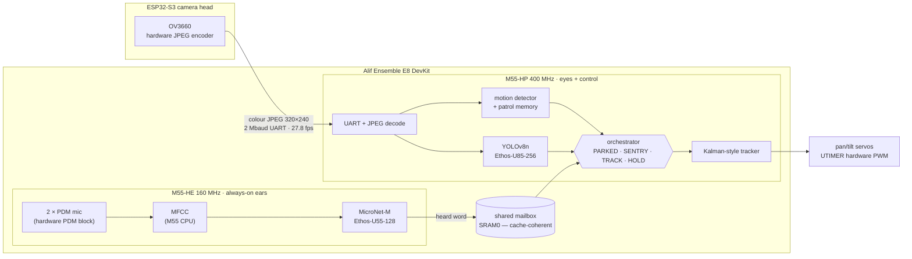
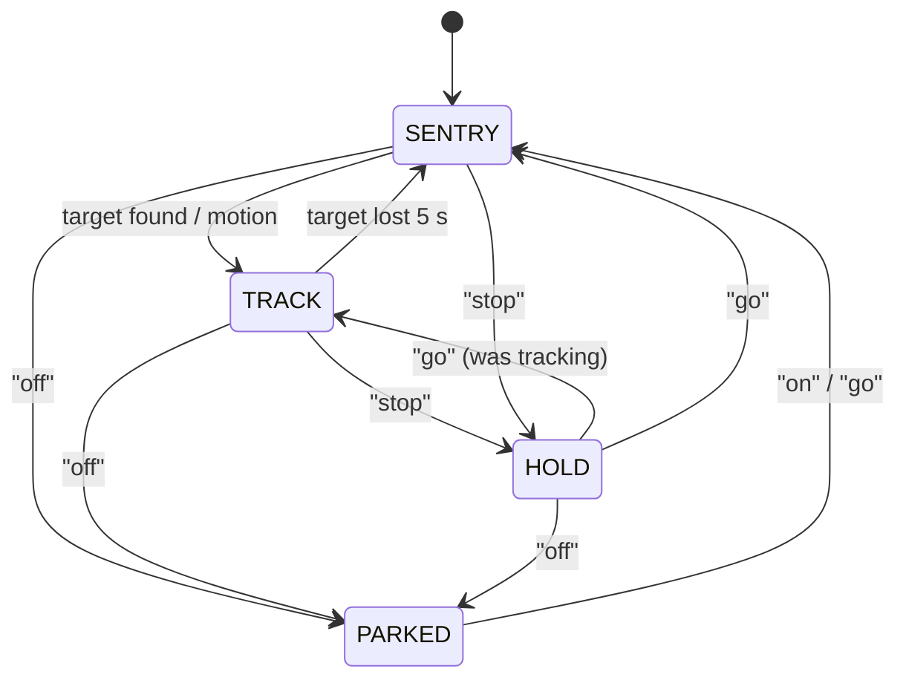

# WALDO — voice-controlled turret on one Alif E8

> Pan/tilt flashlight turret. Finds people, follows them, obeys voice commands.  
> Two ExecuTorch models. Two NPUs. Two cores. No PC. No cloud.

---

## What it does

WALDO patrols a room, spots people with its camera, points its flashlight at them and keeps
following. You steer it by voice. Everything runs on a single **Alif Ensemble E8 DevKit** —
no PC, no cloud, no second board.

- 👁 **Sees** — YOLOv8n, 28 room classes, 320 × 320, **100 % on the Ethos-U85** NPU
- 👂 **Hears** — MicroNet-M (fine-tuned), 10 command words, **100 % on the Ethos-U55** NPU
- 🧠 **Decides** — one state machine on the HP core: PARKED → SENTRY → TRACK → HOLD
- 🔦 **Moves** — two servos on **hardware UTIMER PWM**, jitter-free 50 Hz, zero CPU cost

### 📹 Tracking demo

https://github.com/user-attachments/assets/a68f28ef-1706-4824-8a5f-49ceb8560f89

---

## Architecture — two brains, one chip

The E8's dual-core, dual-NPU layout maps cleanly onto the two halves of the problem:
always-on audio sensing on the small core, heavy vision on the big one.



**Every operator of both models runs on an NPU.** The CPU handles branchy work that is
cheaper there: MFCC feature extraction, JPEG decoding, motion comparison, patrol memory,
NMS. Data in (mics, camera) arrives on hardware interrupts while the NPUs run.

`WALDO_TWO_BRAIN=0` flips back to a single-core build (both models on the HP's U85),
making the two-brain benefit directly measurable.

---

## Four states, one orchestrator



| State | What runs | Turret |
|---|---|---|
| **PARKED** | HE microphones only | head down, light off — HP sleeps |
| **SENTRY** | motion every frame (CPU); YOLO **only where something changed** | sweeps a 10-stop Z pattern |
| **TRACK** | YOLO every frame | follows the target |
| **HOLD** | YOLO every frame | frozen on target |

**Patrol memory:** each stop stores a 300-byte pixel-mean snapshot. The second lap of an
unchanged room runs YOLO at **0 of 10 stops**. A single changed cell triggers one focused
re-check — the NPU only wakes for real events.

---

## Voice commands

### 📹 Voice demo

https://github.com/user-attachments/assets/c7e937ec-b346-4782-82a6-bf7b16476e33

**Control:**

| Word | Effect |
|---|---|
| **off** | park (HP sleeps; HE still listens) |
| **on / go** | wake, or resume previous state |
| **stop** | freeze on target |
| **left / right / up / down** | switch to the nearest target in that direction |
| **no** | drop current target, back to following people |
| **home** | return to home position |
| **patrol** | start a patrol sweep |

**Object targeting** — say the object name to lock onto that class:

| Word | Tracks |
|---|---|
| **cup** | cup / mug |
| **bottle** | water bottle |
| **phone** | cell phone |
| **laptop** | laptop |
| **book** | book |
| **backpack** | backpack |
| **keyboard** | keyboard |
| **chair** | chair |

The KWS model is **MicroNet-M fine-tuned** on Google Speech Commands + ElevenLabs TTS
synthetic voices (26 speakers × 10 words) with room and microphone augmentation — giving
**96 % accuracy on clean speech, 80 % at 20 dB noise**.

---

## Performance

| Metric | Result | Where verified |
|---|---|---|
| YOLOv8n frame time on DK-E8 | **29 ms** | board |
| YOLOv8n mAP50 | **0.439** board = 0.439 PC reference | board + FVP |
| YOLOv8n NPU work | 5.19 M cycles · 1.09 GMAC | FVP |
| MicroNet KWS accuracy | **96 %** clean · **80 %** at 20 dB noise | host (synthetic voices) |
| MicroNet on HE U55-128 | 549 k NPU cycles per inference | FVP |
| Camera link | **27.8 fps**, colour JPEG 320 × 240 | camera head |
| SENTRY second lap, unchanged room | YOLO at **0 / 10 stops** | host simulation |

**Memory (two-brain build):**

| Region | HP (vision) | HE (audio) |
|---|---|---|
| MRAM | 3.2 MB / 4.5 MB (YOLO 3.0 MB) | 304 KB / 512 KB |
| SRAM0 | 2.7 MB — YOLO buffers, LCD frame | top 512 KB — KWS pools 320 KB, mailbox 4 KB |
| SRAM1 | 3.9 MB — YOLO scratch 2 MB, camera frames | — |
| TCM | ITCM 142 KB / 256 KB | ITCM 94 KB / 256 KB |

---

## Reliability & reproducibility

- **Boot self-test:** firmware runs KWS on a recorded "yes" and YOLO on a photo of people before entering SENTRY — both results printed to the console.
- **CI on Arm FVPs:** `.github/workflows/fvp-sim.yml` runs YOLOv8n on Corstone-320 (U85) and MicroNet on both Corstone-320 and Corstone-300 (U55-128) on every push.
- **Host tests:** `make -C tests/host` runs the orchestrator, tracker and patrol memory against a simulated room, and tests the two-brain mailbox (restarts, overflow, wrap-around).

---

## Hardware

| Part | Role | Connection |
|---|---|---|
| Alif Ensemble E8 DevKit | main compute | PRG USB — power, flash, console |
| ESP32-S3-CAM (OV3660) | capture + JPEG encode | GPIO14 TX → E8 UART0 RX (P1\_4); GPIO21 RX ← TX (P1\_5) |
| Pan servo | azimuth | J10 pin 27 (P7\_4, UTIMER 10) |
| Tilt servo | elevation | J10 pin 20 (P6\_2, UTIMER 5) |
| Servo supply | 6 V, ground shared with E8 | — |

---

## Build & flash

```sh
cp tools/env.sh.example ~/arm-tools/env.sh   # set toolchain paths
source ~/arm-tools/env.sh
tools/flash.sh   # builds HE + HP images, writes boot table and both MRAM slots
```

Requires CMSIS-Toolbox 2.15, Arm GNU Toolchain 14.3, Alif SETOOLS.  
Full setup → [`documentation/template-guide.md`](documentation/template-guide.md)

---

## Credits

| Component | Licence |
|---|---|
| ExecuTorch hackathon template | Arm · Meta (Apache-2.0) |
| YOLOv8 | Ultralytics **(AGPL-3.0)** |
| MicroNet-M | Arm ML-Zoo (Apache-2.0) |
| Speech Commands | Google (CC BY 4.0) |
| TJpgDec | ChaN (unrestricted) |
