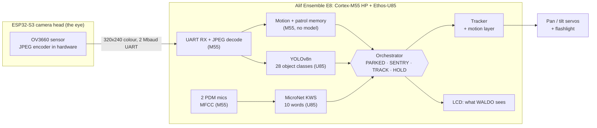
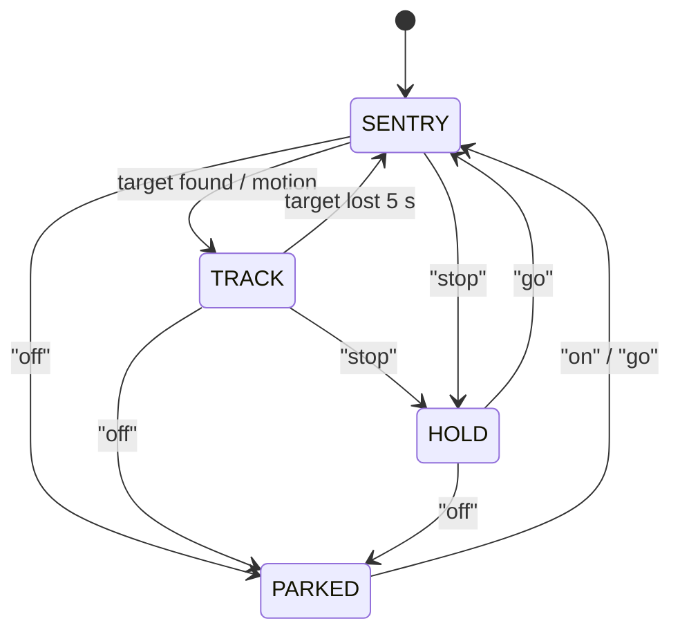

# WALDO: a voice-controlled turret that finds and follows, on one Alif E8

WALDO is a pan/tilt turret with a flashlight. It looks for people and objects with a
camera, points at them, and keeps following them. You steer it by voice: "stop", "go",
"left", "off". All of it runs on the **Alif Ensemble E8 DevKit**, with no PC and no cloud.
Two neural networks run through **ExecuTorch on the Ethos-U85 NPU**: YOLOv8n sees, MicroNet
listens. The Cortex-M55 does the rest.

Built for the Arm + Meta ExecuTorch hackathon on this repository's `hackathon` template.
The original setup guide for the template is in
[documentation/template-guide.md](documentation/template-guide.md).

<!-- demo GIF / photo goes here -->

## How it works



**The hardware split.** The ESP32 is only the eye: it captures, compresses in its own
JPEG hardware, and sends. Every model and every decision runs on the E8. Each job goes to
the unit that fits it:

| Job | Runs on | Why |
|---|---|---|
| Object detection, keyword spotting | **Ethos-U85** via ExecuTorch | dense int8 convolutions; every operator of both models runs on the NPU |
| MFCC audio features, JPEG decode, motion detection, patrol memory, box decoding and NMS | **Cortex-M55** | branchy or small work, cheaper on the CPU than a trip to the NPU |
| Microphone capture, camera bytes | PDM block, UART, both on interrupts | audio and frames arrive while the NPU runs |
| Servo PWM | UTIMER hardware | jitter-free 50 Hz, no CPU cost |

### The orchestrator

The orchestrator is one state machine
([src/waldo/orchestrator.cpp](src/waldo/orchestrator.cpp)). It decides how much work each
camera frame gets, so heavy models run only when there is something to look at.



| State | What runs | Turret |
|---|---|---|
| PARKED | microphones only | head down |
| SENTRY | motion detection on every frame (CPU only); YOLO only where the patrol memory says something changed | patrols: move, settle, look |
| TRACK | the detector on every frame | follows the target |
| HOLD | the detector on every frame | frozen |

**The patrol.** After 4 s of quiet, SENTRY sweeps a Z of 10 stops (pan -70 to 70 degrees,
two tilts). At each stop the turret moves, waits 0.6 s for the servos to settle, then looks
for 0.7 s. Each stop keeps a 300-byte picture of itself (the mean of every 8x8 cell), and
YOLO runs only where that picture changed since the last lap, on a first visit, at every
stop every third lap, or when something moves. On the host test, the second lap of an
unchanged room runs YOLO at 0 of 10 stops, and an object that appears is picked up at the
one stop that sees it ([tests/host/test_orchestrator.cpp](tests/host/test_orchestrator.cpp)).

**Voice commands:**

| Word | Effect |
|---|---|
| off | park |
| on / go | wake up or resume |
| stop | hold still |
| left / right / up / down | while tracking: **switch to the nearest person or object in that direction, and follow that kind of thing** (say "right" to move from a person to the cup beside them); otherwise: nudge the turret 10° |
| no | drop the current target, back to following people |

WALDO follows **people** by default, and aims at the chest rather than the face so the
light stays out of people's eyes. The screen shows the camera view with boxes on what it sees
(the target green, other people yellow, objects cyan) and a bar for the state: red PARKED,
blue SENTRY, green TRACK, yellow HOLD.

## The models

All three go through the same flow as the template's model: PyTorch, then int8 PT2E with
the `EthosUQuantizer`, then the Ethos-U partitioner, then Vela, then a `.pte` embedded in
the image.

| Model | Task | Input | NPU ops | Program | Source |
|---|---|---|---|---|---|
| BlazeFace (v1 turret, FVP self-test) | face detection | 128x128 gray | 100 % | 200 KB | MediaPipe front model, first conv folded to 1 channel ([model/model.py](model/model.py)) |
| **MicroNet-M** | keyword spotting, 10 words | 49x10 MFCC (1 s at 16 kHz) | 42/42 | 170 KB | Arm ML-Zoo, rebuilt in PyTorch from its TFLite weights ([model/kws](model/kws)) |
| **YOLOv8n** | 28 object classes | 320x320 RGB | 99/99 | 3.0 MB | Ultralytics, head sliced to 28 room classes by our vision lead ([model/yolo](model/yolo)) |

Only the float-to-int8 conversions at each model's input and output stay on the CPU.

## Measured

`board` means measured on the DK-E8, and `host` means checked on a PC.

| What | Number | Where |
|---|---|---|
| BlazeFace inference (v1 turret) | **9.4 ms** on the U85 | board |
| Full face-tracking frame (v1): preprocess 3.6 + NPU 9.4 + decode 0.6 + display 12.1 | 25.6 ms (27 % of the CPU at 10 fps) | board |
| Boot self-test: face found on a built-in photo | `Test_result: PASS` | board |
| Microphones: both channels at 16 kHz, no FIFO errors | — | board |
| Camera link, grayscale 160x120 (v1) | 10.4 fps | board |
| Camera link, **colour JPEG 320x240** (v2) | **27.8 fps** at about 3–12 KB per frame | camera head |
| JPEG decode of a 320x240 camera frame | 0.25–0.7 ms on a laptop; the M55 is still to be measured | host |
| KWS: int8 model vs float vs Arm's TFLite original on the sample clips | agree on every word | host |
| YOLOv8n int8 on the team's 12 golden images vs the float model | agree on all but 3 near-threshold detections | host |
| YOLOv8n on a DK-E8 (the team's own export) | 29 ms per frame, mAP50 0.439 board vs 0.439 host | board |
| YOLOv8n compute, from Vela | 1.09 GMAC per frame, 2.0 MB of SRAM scratch, 99/99 operators on the NPU | build |
| Patrol: YOLO runs on a second lap of an unchanged room | 0 of 10 stops | host |

### Optimisations

- **The camera sends JPEG**, compressed by the sensor's own hardware. Colour at 4x the
  pixels and 2.7x the frame rate, over the same 2 Mbaud UART.
- **The patrol remembers each stop.** A 300-byte picture per stop decides whether YOLO
  needs to look again, so an unchanged room costs the NPU nothing on most laps.
- **Audio features are computed as audio arrives.** Each 20 ms of audio adds one MFCC
  frame, so a 1 s window never needs recomputing; the NPU classifies it every 200 ms.
- **The NPU only sees work it is good at.** Every operator of every model is delegated.
- **Per-stage timing**: every 2 s the board prints mean and worst time per stage
  (preprocess, forward, decode, orchestrator, display), which is how we found that the display,
  not the NPU, is the most expensive stage. The Ethos driver's begin/end hooks time the NPU's
  own work separately, so `forward` minus `NPU busy` is what the CPU spends converting the
  input to int8 and the outputs back.

## Hardware

| Part | Connection |
|---|---|
| Alif Ensemble E8 DevKit | PRG USB for power, flashing and the console |
| Pan servo | J10 pin 27 (P7_4, UTIMER 10) |
| Tilt servo | J10 pin 20 (P6_2, UTIMER 5) |
| Servo power | separate 6 V supply, ground shared with the E8 |
| ESP32-S3-CAM (OV3660) | GPIO14 (TX) → E8 UART0 RX (P1_4); GPIO21 (RX) ← E8 UART0 TX (P1_5); J10 pins 33 / 35 (check the TX/RX labels against your board); shared ground |

The J10 header is level-shifted to 3.3 V on the DevKit. The servo signals connect directly.

## Two-brain (branch `two-brain`)

The M55-HE and its Ethos-U55-128 listen all the time; the M55-HP and the Ethos-U85 see and
steer, and sleep between interrupts. The HE posts heard words to a mailbox in SRAM0. See
[he/README.md](he/README.md). Not yet run on a board.

## Build and run

You need CMSIS-Toolbox 2.15, Arm GNU Toolchain 14.3 and Alif SETOOLS (see
[documentation/template-guide.md](documentation/template-guide.md)).

```sh
cp tools/env.sh.example ~/arm-tools/env.sh   # edit the paths
source ~/arm-tools/env.sh
tools/flash.sh            # build, write the boot table and the image to MRAM (SW4 on SEUART)
# SW4 to UART4, press reset; console at 115200 on the PRG USB port
```

The camera head is in the team's firmware repository (`firmware/esp32cam`, PlatformIO).

To re-export a model:

```sh
python create_ai_layer.py cmsis-executorch.cbuild-mlops.yml                   # BlazeFace -> ai_layer/
.venv/bin/python model/kws/export_kws.py cmsis-executorch.cbuild-mlops.yml    # keyword spotter -> src/kws_pte.c
<venv with ultralytics>/bin/python model/yolo/export_yolo.py cmsis-executorch.cbuild-mlops.yml <images>
make -C tests/host                                                            # orchestrator host test
```

At boot the board tests itself and prints `KWS_result` (a recorded "yes") and `YOLO_result`
(a photo of people). The FVP build prints `Test_result` (BlazeFace on a face photo). Then it runs a servo test and starts in SENTRY.

## Things we learned about the E8

- **Booting from MRAM without a debugger leaves SRAM0 and SRAM1 unpowered.** The template's
  startup code zeroes SRAM0 before `main()`, so the image hangs silently. We power both
  banks through the Secure Enclave right after the console is up
  (`SERVICES_power_memory_req`), and startup no longer touches them
  ([board/DevKit-E8/main.c](board/DevKit-E8/main.c)).
- **The Ethos-U85 sees the M55's TCM only at its global alias.** With ExecuTorch's pools in
  DTCM the NPU failed with status 0x9004: the driver passed the core's local address.
  We override the driver's `ethosu_address_remap` to translate it
  ([board/DevKit-E8/ethos_setup.c](board/DevKit-E8/ethos_setup.c)); the large pools still
  sit in SRAM.
- The UTIMER driver needs a non-NULL callback. Servo channels need compare buffering off,
  or the duty cycle never changes.
- Arm's quantizer does not fuse `relu6` with a convolution in this ExecuTorch version, and
  the partitioner then splits the graph. `clamp(0, 6)` gives the same result and keeps
  the whole network on the NPU.

## Status

**Works on the board (v1, branch `waldo`):**
- face tracking with BlazeFace on the NPU
- camera link, servo tracking, the LCD view
- microphones
- standalone boot with the self-test

**Built and host-tested, waiting for a board:** our DevKit failed during the hackathon.
- keyword spotting live
- the orchestrator
- the JPEG camera path
- the patrol with per-stop memory
- YOLOv8 in the firmware: the app's MRAM slot grows to 4.5 MB and the HE slot shrinks to
  512 KB; the model is embedded as is (`src/yolo_pte.S`); its pools sit in SRAM0 and SRAM1
  (`WALDO_NPU_SRAM0_ONLY` puts both NPU pools in SRAM0 instead); a boot self-test runs it on
  a photo of people

**Next steps:**
- Two-brain: listening on the **M55-HE + Ethos-U55** is built on branch `two-brain` (see
  above); next, motion detection there too, and the HP powered down in SENTRY.
- Measure the power difference.

## Credits and licences

- The template: Arm (Apache-2.0).
- BlazeFace: MediaPipe weights via hollance/BlazeFace-PyTorch (Apache-2.0).
- MicroNet-M: Arm ML-Zoo (Apache-2.0).
- Speech Commands clips: CC BY 4.0.
- TJpgDec: ChaN (no restrictions on use).
- **YOLOv8: Ultralytics, AGPL-3.0.**
